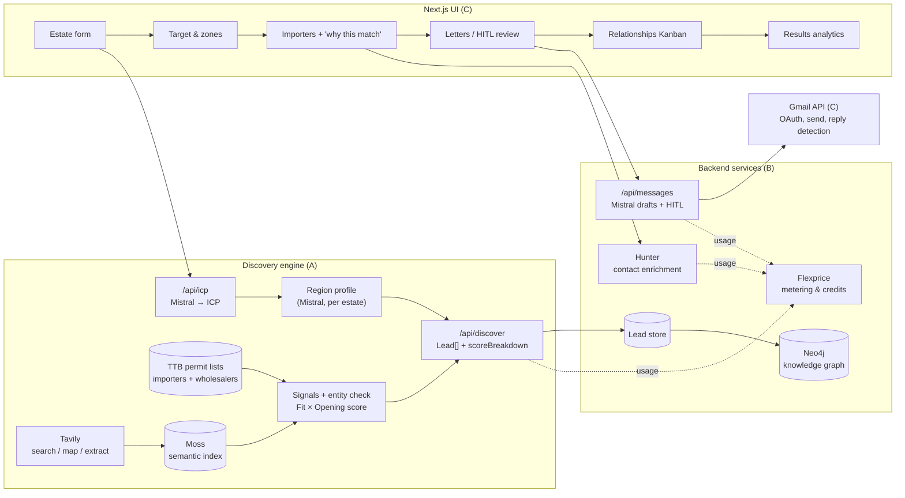

# Millésime — System Design & Architecture

> Find the US importer made for your wine.
> Built in one day at **HackwithBay 4.0** (AWS Builder Loft, San Francisco, 24 November 2026).

Millésime is an AI go-to-market engine for small French wine estates that want to export to the United States. US law requires every foreign wine to enter through a federally licensed importer, then a state-licensed distributor (the *three-tier system*). A small estate has no export team and no way to tell which of the ~4,700 licensed importers in California would actually carry its wine.

Millésime takes the estate's own description, infers the ideal US buyer, finds **real** licensed importers, proves each match with cited public evidence, drafts outreach that a human approves, and tracks every lead to a signed deal.

**Design principle: no invented lead, no unproven claim.** Every importer comes from the federal permit registry, every scoring signal carries the sentence and URL that prove it, and every signal is checked to be about the right company.

---

## 1. Architecture at a glance

| Layer | Technology | Role |
|---|---|---|
| Frontend | Next.js 15 (App Router), React 19, Tailwind CSS 4 | 11-screen flow, client state, US map |
| Reasoning | Mistral (`mistral-medium-latest`, JSON mode) | ICP, region profile, portfolio extraction, signal detection, entity check, outreach drafts |
| Discovery | Tavily (search, map, extract) | Live web evidence on each importer |
| Retrieval | Moss (`@inferedge/moss`) | Semantic index of every page chunk; returns the snippets closest to the ICP |
| Ground truth | TTB federal permit lists (importer + wholesaler, CSV) | Only licensed companies can become leads |
| Knowledge graph | Neo4j | Companies, people, competitors, signals; appellation gaps and warm intros |
| Enrichment | Hunter (domain search) | Decision-maker emails, with an honest "no verified contact" fallback |
| Messaging | Gmail API (OAuth) | Send in thread, reply detection, locked demo recipient |
| Billing | Flexprice | Usage metering, credit wallet, credit-gated enrichment |
| Hosting | Render (Node web service) | Auto-deploy on every push to `main` |

---

## 2. End-to-end flow

1. **Intake (Estate page).** The winemaker confirms a pre-filled form: name, region, appellations, grapes, farming, ex-cellar price, bottles available for the US, website, description.
2. **ICP (`POST /api/icp`).** Mistral turns the estate into an *Ideal Customer Profile* of the US buyer: buyer types, NAICS 424820, states and metros, size band, personas, portfolio fit, price band, triggers, negative signals, a 0–1 confidence per field, and expansion segments the user can accept or dismiss.
3. **Discovery (`POST /api/discover` with `{ icp, domaine }`).** Returns scored `Lead[]` (see §3).
4. **Importers screen.** Leads sorted by fit score, tiers A/B/C, and a *why this match* panel built from `scoreBreakdown`: every signal, its points, the verbatim snippet, the source URL, and an **angle** (how to approach this importer).
5. **Enrichment.** Hunter resolves a decision-maker email from the importer's domain. If nothing verified is found, the lead says so; no email is ever invented.
6. **Outreach with human-in-the-loop.** Mistral drafts a personalized letter from the lead's proven signals (A/B variants). A human approves, edits or rejects every message before anything is sent.
7. **Send & track.** Gmail sends in thread to a locked demo recipient; replies are detected. The Kanban tracks `Matched → Contacted → Replied → Samples sent → Tasting → Signed / Lost`, and every move is attributed to the **agent** or the **rep**.
8. **Results.** Funnel, conversion by stage, A/B performance of openings, AI vs human actions.

---

## 3. Discovery engine (owner A)

### 3.1 Candidate pool
- **TTB-first.** The federal importer and wholesaler permit lists (`data/ttb/`) are filtered to the target state, deduplicated, and cleaned of spirits/beer-only names, mega-distributors and wineries. Holding both permits marks an *importer-distributor*.
- **Reverse search.** Topic queries generated from the estate's region profile (e.g. "California importer Loire Valley growers") find companies that already talk about this kind of wine; only names that **match a TTB permit** are kept.
- **Lookalikes.** Peer estates of the same region are searched to find which importers already carry them.

### 3.2 Evidence collection
- **Tavily search** per candidate (`"<name>" California wine importer portfolio`) plus targeted signal queries.
- **Portfolio extraction.** Tavily *map + extract* reads the importer's own producers/portfolio pages; Mistral turns them into a structured portfolio (producer, country, region, appellation, grapes, verbatim quote, URL).
- **Retail evidence.** Shop pages that say "imported by …" give independent proof when an importer's site is unreadable.
- **Moss retrieval.** Every page chunk is indexed in Moss (index name = content hash, so unchanged content is never re-indexed). For each candidate, Moss returns the snippets closest to the ICP; only those are sent to Mistral. Fallback: Mistral embeddings in memory, same interface.

### 3.3 Region profile (generic engine)
`regionProfile(domaine)` asks Mistral, in JSON mode, for the estate's region, own appellations, same-region appellations, neighbor regions, styles, and the reverse/peer/retail queries to run. Every label, Tavily query, Mistral instruction, saturation and competitor rule is derived from this profile and from the estate (price, bottles, grapes). Nothing is hardcoded to one region. The engine was validated on a Touraine estate (demo) and on a Côte Chalonnaise (Burgundy) test estate.

### 3.4 Scoring
Signals are configured in `src/lib/signals.ts` (id, label, weight, query template, detection instruction).

- **Fit** (does this importer sell this kind of wine?): organic/natural focus, small family growers, region specialist, neighbor regions, price-range overlap.
- **Opening** (is there room for this wine?): portfolio hole for the estate's appellations, boutique size compatible with the export volume, tastings as an entry point; minus saturation (2+ estates from the same appellation) and direct competitors (same appellation, style and price).
- `fitScore = 0.6 × Fit + 0.4 × Opening`; tiers **A ≥ 60**, **B ≥ 40**, C below.
- Each lead gets an **angle** line, e.g. *"Loire book without Vouvray: pitch our organic Vouvray as the missing appellation; ask for a slot at their portfolio tasting."*
- The estimated **US shelf price** (EUR→USD, EU tariff, importer, distributor and retailer margins, all editable assumptions) is shown as an info line.

### 3.5 Verification rules (why the leads can be trusted)
| Rule | What it prevents |
|---|---|
| Lead must match a TTB permit; the importer's own site must match the permit city/name, else tier capped at C | Leads that cannot legally import, or a wrong company |
| **Entity check**: Mistral reads each fired signal in context and answers `same_company` / `sister_or_related_company` / `different_company` / `unclear`; only `same_company` counts | Homonyms (e.g. *Sylvester/Rovine* in California vs. *Zev Rovine Selections* in New York) |
| Pages about other companies rejected (LinkedIn profiles of other firms, third-party PDFs, press about namesakes) | Borrowed portfolios |
| AI-generated profile pages never count; producer sheets never prove an importer's focus; own-site claims must be in the importer's voice | Circular or misattributed evidence |
| Hiring signals need a dated source (< 12 months) and a named role | Stale LinkedIn posts |
| Coverage tracked ("catalogue read: 26/143"); absence on a partially read catalogue becomes `unknown`, never a negative | False "portfolio hole" or false "saturation" |

### 3.6 Caching and cost control
- Every external call is cached on disk and committed (`data/cache/`: Tavily results, portfolios, judgments, entity checks, ICPs, region profiles, discover runs). The demo estates are served in < 1 s with zero paid calls.
- Cache keys are hashes of the ICP and estate; any change triggers a live run.
- Live runs are capped per run (`TAVILY_RUN_BUDGET`, default 40 credits, in-flight calls counted), per IP (`LIVE_IP_MAX`) and globally (`LIVE_GLOBAL_MAX`). `/api/icp` has its own counter.
- `/api/discover` reports its mode in headers: `x-mode: cache | live | cache-latest` and `x-reason`.

---

## 4. Knowledge graph (owner B)

Neo4j holds the domain model, synced in the background after each discovery or message event (API responses never wait on it). An in-memory graph is used if Neo4j is not configured.

- **Nodes:** `Product` (the estate's wine), `Company` (importers), `Person`, `Competitor` (estates an importer already carries), `Signal`.
- **Edges:** `matched_to {fitScore, tier}`, `works_at`, `previously_employed_at`, `contacted_via`, `replied_to`, `carries`, `competes_with`, `has_signal`.
- **Graph reasoning:** *appellation gaps* (importers whose book covers the region but not the estate's appellations) and *warm intros* (people linked through shared past employers).
- Live at submission time: 605 nodes, 1,151 edges, 8 appellation-gap matches, 2 warm-intro paths for the demo estate.

## 5. Enrichment, outreach and billing (owner B)

- **Enrichment:** Hunter domain search on the importer's website; best decision-maker email with its verification status. Without a verified result, the contact is marked unknown.
- **Messages (`/api/messages`):** `draft` (Mistral, personalized from proven signals), `edit`, `approve`, `reject`, `send`. Nothing leaves without human approval; edits are logged as rep actions.
- **Flexprice:** metered events `Leads Discovered`, `Searches Run`, `Leads Enriched`, `Outreach Sent`, `Graph Queries Evaluated`, each with a credit and USD cost. The organization's credit wallet gates high-cost actions: enrichment is blocked when credits run out, and a top-up dialog appears.
- **Audit trail:** every stage move and outbound action is a `LeadEvent` with actor (`agent` / `rep`) and timestamp; the *Agent Thinking* feed shows planner, discovery, graph, enrichment, writer, reviewer and billing steps live.

## 6. Frontend (owner C)

Next.js App Router, client state in `src/lib/app-state.tsx`, design system in `src/components/ui.tsx`.

Screens: Welcome → Estate → Target (California zones, US map of licensed importers per state) → Importers → Letters (HITL review) → Relationships (Kanban) → Results → Credits → Profile.

Gmail: OAuth connect at first send, send in thread, reply detection. A required safety net (`GMAIL_DEMO_RECIPIENT`) routes every letter to a test inbox unless real sending is explicitly enabled.

## 7. API reference

| Route | Method | Purpose | Owner |
|---|---|---|---|
| `/api/icp` | POST | Estate → ICP (cache first) | A |
| `/api/discover` | POST | `{ icp, domaine }` → scored `Lead[]` | A |
| `/api/leads` | GET/POST | Lead store: list, ingest, enrich, stage moves | B |
| `/api/messages` | GET/POST | Draft, edit, approve, reject, send | B |
| `/api/graph` | GET | Graph snapshot, appellation gaps, warm intros | B |
| `/api/billing` | GET/POST | Credit balance, usage breakdown, top-up | B |
| `/api/states` | GET | Licensed importers per state (map) | C |
| `/api/gmail/[action]` | GET/POST | OAuth, callback, send, replies | C |

The shared data contract is `src/lib/types.ts` (`Domaine`, `ICP`, `Lead`, `ScoreItem`, `PortfolioItem`, `Message`, `LeadEvent`, `ThoughtLog`).

## 8. Security

- All API keys are server-side only (never `NEXT_PUBLIC_`), stored in `.env.local` locally and in Render's environment in production; `.env*` is git-ignored.
- Cache-first serving and live-run caps protect paid credits on the public site.
- Outbound email is locked to a test inbox by default.

## 9. Deployment

Render web service, Node, auto-deploy on push to `main`.
- Build: `npm install --onnxruntime-node-install-cuda=skip && npm run build` (Moss's ONNX runtime otherwise tries to download GPU binaries).
- Start: `npm run start`.
- Environment: see `.env.example`.

## 10. Known limitations and next steps

- A live discovery run takes about 3 minutes (dozens of Tavily and Mistral calls, Moss indexing on a small instance). Next: stream leads as they are scored, use a smaller model for checks, precompute known importers.
- Contacts depend on Hunter's coverage of small importers' domains.
- The region profile is generated by Mistral and can be imperfect (it is cached and visible; it should become editable).
- **Next data source:** US customs bills of lading show which importer actually receives shipments from which estate, a stronger proof of portfolio than websites.
- Expansion beyond California: the TTB registry covers every state; the target screen already shows other states as "coming next".

## 11. Team

| Who | Part | Main files |
|---|---|---|
| **Daniel Duong** (A) | Intake & ICP, discovery engine (TTB, Tavily, Moss, signals, entity check, Fit × Opening scoring, generic region profile), caching, Render deployment | `src/app/api/{icp,discover}`, `src/lib/{llm,discovery,retrieval,signals}.ts`, `data/` |
| **Arthur Moracchini** (B) | Neo4j knowledge graph, Hunter enrichment, Mistral outreach & HITL workflow, Flexprice billing, lead store | `src/app/api/{leads,messages,graph,billing}`, `src/lib/{graph,enrich,billing,store}.ts` |
| **Colomban Dubreuil** (C) | Product design and UI (11 screens), app state, Gmail integration, US map and zones, results analytics, project setup | `src/app/**/page.tsx`, `src/components/`, `src/lib/{app-state,gmail,places}.ts`, `src/app/api/{states,gmail}` |

Built with Claude Code. Team coordination on Teamily.
